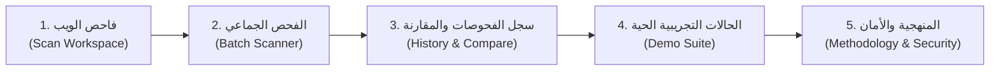

# دليل العرض التوضيحي للأستاذ ولجنة المناقشة — SecureAct AI
## Presentation & Live Demonstration Guide

هذا الدليل أُعد لمساعدتك في استعراض منصة **SecureAct AI** أمام الدكتور أو لجنة التحكيم بصورة علمية وهندسية تبرز نضج المنصة كمنتج أمني متكامل يجمع بين الاستدلال الذكي الفعلي والدفاعات الشبكية المتقدمة.

---

## 1. فلسفة العرض والرسالة الأساسية (Core Thesis)

- **ما الذي تقدمه المنصة؟** منتج ويب أمني عملي وقائم على الذكاء الاصطناعي لكشف محاولات حقن الأوامر (*Prompt Injection*) في صفحات الويب ومستندات HTML قبل وصولها إلى وكلاء الذكاء الاصطناعي (*AI Web Agents*).
- **نقطة القوة الأكاديمية الأولى:** جميع النتائج المعروضة تُحسب لحظياً عبر استدعاء نموذج `SecureAct_AI_v2` الفعلي ومصنف `LinearSVC` ودالة القرار الرياضية `decision_function()`؛ لا توجد أي بيانات صورية أو نتائج ثابتة مسبقاً.
- **نقطة القوة الأكاديمية الثانية:** الشفافية العلمية الكاملة؛ فالمنصة تعرض بصراحة معدل الإنذار الكاذب (6.03%) وتشرح حدوده، بدلاً من الادعاء التسويقي بوجود أمان بنسبة 100%.
- **نقطة القوة الهندسية:** دمج نموذج الذكاء الاصطناعي مع محرك حماية شبكي صارم يمنع ثغرات SSRF ويفحص DNS والتحويلات قبل جلب أي صفحة.

---

## 2. المسار التطبيقي المقترح للعرض المباشر (Step-by-Step Demo Flow)

---

### الخطوة الأولى: فاحص الويب ومساحة التحليل الرئيسية (Web Scanner)
1. **استعراض واجهة العمل:** وضّح للدكتور أن المنصة صُممت بواجهة عربية تقنية افتراضياً تدعم RTL بالكامل، مع إمكانية التبديل الفوري للغة الإنجليزية بنقرة واحدة من شريط التنقل.
2. **تجربة فحص رابط ويب (URL Scan):**
   - أدخل رابطاً تجريبياً أو استخدم الزر السريع (مثل `https://example.com`).
   - اضغط **"بدء فحص الرابط"**؛ ووضّح للدكتور شريط المراحل الحركي:
     `1. فحص النطاق وSSRF` &rarr; `2. جلب صفحة الويب` &rarr; `3. تحليل النموذج LinearSVC`.
   - استعرض النتيجة: درجة القرار (مثلاً `-1.22`)، وهامش الأمان دون العتبة، وزمن الاستجابة بالميلي ثانية.
3. **استعراض مناعة المنصة ضد هجمات SSRF (نقطة قوة أمنية ممتازة):**
   - أدخل رابطاً محلياً مثل `http://127.0.0.1:8000/docs` أو `http://169.254.169.254/latest/meta-data/`.
   - اضغط فحص؛ وضّح للدكتور كيف يتدخل محرك الأمان فوراً بحظر الطلب:
     `حظر أمني SSRF: العنوان يشير إلى شبكة محلية أو نطاق محظور`.
   - وضّح أن **نموذج الذكاء الاصطناعي لم يُستدعَ إطلاقاً** لحماية موارد الخادم، وتأكيداً على عزل طبقة الشبكة عن طبقة الاستدلال.
4. **تجربة فحص الأنماط عبر الأزرار السريعة (Direct Content Presets):**
   - انتقل إلى تبويب "محتوى مباشر":
     - **مقال تقني سليم (Safe Guide):** اضغط الزر وافحص &larr; درجة سالبة وتصنيف "سليم (Benign)".
     - **هجوم تجاوز صريح (Direct Override):** اضغط الزر وافحص &larr; قفزة في الدرجة تتجاوز العتبة مع إنذار أحمر "مؤشر حقن تعليمات محتمل".
     - **هجوم وسوم مخفية (Hidden CSS Injection):** افحص النص الذي يحتوي `style="display:none"`؛ واشرح للدكتور كيف أن مصفوفة الأحرف (Char n-grams من 3 إلى 5) قادرة على رصد وسوم الإخفاء الهيكلية حتى وإن كانت غير مرئية للمستخدم البشري.

---

### الخطوة الثانية: الفحص الجماعي للروابط (Batch URL Scanner)
1. انتقل لتبويب "فحص جماعي".
2. ضع قائمة تحتوي روابط صالحة ورابطاً داخلياً محظوراً (مثل 127.0.0.1).
3. اضغط **"فحص مجموعة الروابط"**؛ ووضّح للدكتور:
   - آلية التزامن المقيد (حد أقصى 3 عمليات جلب متزامنة لمنع استنزاف الموارد).
   - **عزل الإخفاقات (Isolated Failure Handling):** فشل أحد الروابط أو حظره لا يوقف بقية الفحص ولا يفسد النتائج.

---

### الخطوة الثالثة: سجل الفحوصات والمقارنة وتصدير التقارير (History & Compare)
1. افتح صفحة **"سجل الفحوصات"**؛ وضّح للدكتور:
   - أرشفة جميع الفحوصات محلياً في متصفح العميل مع الحفاظ التام على الخصوصية (عدم حفظ نصوص المستخدم الكاملة).
2. **مقارنة نتيجتين (Side-by-Side Comparison):**
   - حدد صندوق الاختيار بجانب فحص سليم وفحص يحتوي على حقن، ثم اضغط **"مقارنة النتيجتين"**.
   - استعرض نافذة المقارنة التي تقارن درجات القرار والهامش والأداء جنباً إلى جنب.
3. **تصدير التقارير:**
   - استعرض زر **"نسخ الملخص"** وزر **"تنزيل تقرير JSON"**.
   - اضغط زر **"طباعة التقرير"**؛ ووضّح كيف تتحول الشاشة فوراً إلى تنسيق طباعة أكاديمي ورسمي نظيف يخفي الأزرار غير اللازمة ليتناسب مع التصدير إلى PDF.

---

### الخطوة الرابعة: حزمة الاختبارات الميدانية الحية (Demo Cases)
1. افتح صفحة **"حالات تجريبية"**.
2. اضغط زر **"تشغيل كافة الحالات الحية"** (Run All Live Cases) أمام الدكتور.
3. وضح كيف يستدعي المتصفح الخادم لتقييم الحالات الست لحظياً.
4. **أبرز الحالة الخامسة (إنذار كاذب لمقال أمني):**
   - وضّح للدكتور بنزاهة أكاديمية أن المقال سليم ولكنه يستشهد بعبارات هجومية؛ فقام النموذج بوسمه كاشتباه.
   - اشرح أن هذا تجسيد عملي لنسبة الإنذار الكاذب (6.03%) التي يفرضها اعتماد النموذج على الخصائص السطحية TF-IDF، وهو ما يؤكد ضرورة استراتيجية الدفاع في العمق وعدم الاعتماد على الذكاء الاصطناعي وحده.

---

### الخطوة الخامسة: المنهجية العلمية والنزاهة الإحصائية (Methodology)
1. استعرض بطاقات المقاييس الأربعة: الدقة (94.46%)، والاستدعاء (94.95%)، والإنذار الكاذب (6.03%)، وROC-AUC (98.40%).
2. استعرض مصفوفة الالتباس (TN: 670, TP: 677, FP: 43, FN: 36).
3. استعرض التحقق الفوري من بصمة التشفير `SHA-256` التي تضمن عدم العبث بملف النموذج.
4. وضح فواصل الثقة 95% ومصدر البيانات BrowseSafe++ بترخيص CC BY 4.0 من Perplexity AI.

---

## 3. الأسئلة المتوقعة من الدكتور وإجاباتها النموذجية

* **س: هل النتيجة التي يعرضها النموذج هي نسبة مئوية للاحتمالية؟**  
  **الجواب النموذجي:** "لا يا دكتور؛ المصنف المستخدم هو `LinearSVC` وهو بطبيعته ينتج مسافة هندسية مباشرة عن المستوى الفاصل عبر دالة القرار $f(x) = \mathbf{w}^T \phi(x) + b$. وتتم مقارنة هذه المسافة بالعتبة المعايرة رياضياً (`-0.237542`). تحويل هذه المسافة لاحتمالية مئوية اصطناعية كان ليشوه الترتيب الحقيقي للعينات الحدية، لذا فضلنا الدقة الرياضية المباشرة."

* **س: لماذا لم تُعتمد عتبة الصفر (0.0) الافتراضية؟**  
  **الجواب النموذجي:** "عتبة الصفر الافتراضية كانت ستؤدي لنسبة إنذار كاذب أعلى تعيق استخدام التطبيقات الحقيقية. قمنا ببروتوكول معايرة مقيد على عينة مستقلة (`v2_threshold_calibration`) هدفه تعظيم نسبة الاكتشاف بشرط ألا يتجاوز الإنذار الكاذب 5%. ووجدنا أن العتبة `-0.237542` تحقق التوازن الأمثل بنسبة اكتشاف تقارب 95%."

* **س: كيف يحمي فاحص الروابط الخادم الداخلي إذا أدخل المستخدم رابطاً خبيثاً؟**  
  **الجواب النموذجي:** "تطبق المنصة محرك حماية SSRF متقدم؛ حيث يقوم بحل اسم النطاق عبر DNS أولاً والتأكد من أن جميع عناوين IP المسترجعة لا تقع ضمن الشبكات الخاصة أو المحلية أو عناوين السحابة الحساسة (169.254.x). كما يتحكم الخادم في عمليات التحويل (Redirects) ويعيد فحص كل عنوان جديد، ويحدد المنافذ المسموحة بحزم."

* **س: هل يمكن الاعتماد على SecureAct AI كبوابة أمنية وحيدة وكافية؟**  
  **الجواب النموذجي:** "بكل تأكيد لا يا دكتور؛ وهذا مبدأ أصيل موثق في ملفات الأمان `SECURITY.md` والبطاقة الفنية `MODEL_CARD.md`. النموذج مصمم كفلتر أولي سريع وخفيف لمعالجة التدفقات الكبيرة، ويجب أن تتكامل معه طبقات دفاعية أخرى مثل عزل سياق وكيل الذكاء الاصطناعي، ومراقبة المخرجات، وتطبيق الامتيازات الأقل (*Principle of Least Privilege*)."
