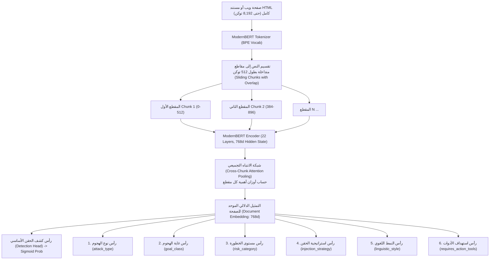
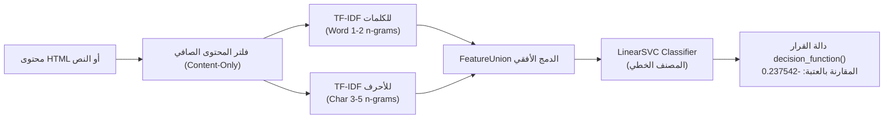

# SecureAct AI — Dual Scientific Methodology & Evaluation Protocol
## المنهجية العلمية المزدوجة، هندسة الانتباه العصبي، وبروتوكول التقييم المقارن

توثق هذه الورقة الأسس العلمية والرياضية التي بني عليها محرك الاستدلال والاستخبارات الجنائية المعتمد **SecureAct Horizon v3 (ModernBERT 141M)**، بالإضافة إلى توثيق الأسس الإحصائية لخط الأساس المرجعي التاريخي **SecureAct AI v2 (`LinearSVC` + TF-IDF)**، مع تحليل مقارن للمنهجيتين في كشف حقن التعليمات غير المباشر (*Indirect Prompt Injection*).

---

# القسم الأول: المنهجية العصبية العميقة المعتمدة (SecureAct Horizon v3)

## 1. بنية الانتباه المقطعي للنصوص الطويلة (Chunk-Attention Long-Context Pooling)

تواجه نماذج المحولات اللغوية (*Transformers*) عقبة تعقيد الانتباه التربيعي $O(N^2)$ عند معالجة صفحات الويب الطويلة. صُمم نموذج **Horizon v3** ليتغلب على هذا التحدي عبر بنية انتباه مقطعي متقدمة تمتد حتى **8,192 توكن**:

### المزايا العلمية لبنية Chunk-Attention:
1. **معالجة النصوص الطويلة دون بتر:** تحتفظ بكامل السياق لصفحات الويب الغنية بالمحتوى (مثل مقالات ويكيبيديا والمواقع التقنية) دون التضحية بأي أجزاء قد يختبئ فيها كود الحقن في ذيل الصفحة.
2. **رصد الهجمات المتفرقة (*Needle-in-a-Haystack*):** يحدد رأس الانتباه التجميعي المقاطع التي تحتوي على محفزات استدراج حتى لو كانت تشكل 1% فقط من إجمالي محتوى الصفحة.

---

## 2. دالة الخسارة متعددة المهام والتدريب التقابلي (Multi-Task & Contrastive Loss)

تم تدريب نموذج Horizon v3 باستخدام دالة خسارة مركبة وموزونة (*Composite Multi-Task Loss*) تضمن توافق كافة الرؤوس الجنائية وتمايز فضاء التضمين:

$$\mathcal{L}_{\text{total}} = \lambda_{\text{det}} \mathcal{L}_{\text{BCE}} + \sum_{i=1}^6 \lambda_i \mathcal{L}_{\text{CE}}^{(i)} + \alpha \mathcal{L}_{\text{contrastive}}$$

حيث:
- $\mathcal{L}_{\text{BCE}}$: خسارة الاعتلاج الثنائي لرأس كشف الحقن الرئيسي.
- $\mathcal{L}_{\text{CE}}^{(i)}$: خسائر الاعتلاج المتقاطع للرؤوس الجنائية الستة (النوع، الغاية، الخطورة، الاستراتيجية، النمط، الأدوات).
- $\mathcal{L}_{\text{contrastive}}$: خسارة تقابلية على أزواج صفحات الويب المتطابقة (*Hard Adversarial Pairs*) لتقريب تمثيل الصفحة السليمة من نسختها المعدلة في الخصائص الطبيعية، مع إبعادها تماماً في فضاء التهديد.

---

## 3. معايرة احتمالية القرار الأمني (Calibrated Probability Spectrum)

- على عكس دوال المسافة التقديرية، ينتج Horizon v3 درجات احتمالية حقيقية $P \in [0.0, 1.0]$.
- تم ضبط العتبة التشغيلية المعتمدة للمنصة عند **`74.8%`** ($0.748$) لتحقيق توازن مثالي بين صفرية الإنذار الكاذب على المقالات العامة وبين الحساسية الفائقة للهجمات المعقدة.
- تُحسب مسافة الأمان (*Safety Margin*) بالعلاقة:
  $$\text{Margin} = P(\text{threat}) - \text{Threshold}$$

---

# القسم الثاني: منهجية خط الأساس التاريخي (SecureAct AI v2 Baseline)

## 4. هندسة الخصائص السطحية لخط الأساس (v2 Surface Feature Engineering)

اعتمد نموذج v2 التاريخي على دمج مصفوفتي TF-IDF أفقياً عبر `FeatureUnion`:

### تفاصيل مصفوفات TF-IDF:
1. **مستوى الكلمات (Word n-grams 1-2):** يلتقط الأوامر الصريحة (`ignore previous instructions`, `system override`).
2. **مستوى الأحرف (Char n-grams 3-5):** يلتقط وسوم HTML المخفية (`display:none`, `visibility:hidden`, `font-size:0px`).

---

## 5. بروتوكول معايرة عتبة v2 وتقسيم العينات (v2 Calibration & Splitting)

- **معادلة المصنف الخطي:**
  $$f(x) = \mathbf{w}^T \phi(x) + b$$
- **المعايرة المقيدة:** خضع نموذج v2 لمسح عتبة مستقل على عينة `v2_threshold_calibration` (1,426 صفحة) استقر عند:
  $$\theta^* = -0.23754153513923493$$
- **عزل أقسام البيانات في خط الأساس:**
  - `v2_train` (13,312 صفحة): تعلم أوزان المصنف وTF-IDF.
  - `v2_development` (2,852 صفحة): استكشاف معلمات n-grams.
  - `v2_threshold_calibration` (1,426 صفحة): تحديد العتبة التشغيلية.
  - `v2_local_test` (1,426 صفحة مجمدة): قياس مقاييس الأداء لمرة واحدة (94.46% دقة، 6.03% FPR).

---

## 6. التحليل المقارن: لماذا تفوق Horizon v3 على TF-IDF؟ (Comparative Analysis)

| التحدي الأمني الميداني | سلوك نموذج TF-IDF (v2 السابق) | سلوك نموذج ModernBERT (Horizon v3 المعتمد) |
|---|---|---|
| **هجمات استدراج الأدوات (Tool Execution Lures)** | يُخفق إذا لم يستخدم المهاجم كلمات تجاوز مألوفة، مثل التمويه بأوامر قراصنة أو طلبات نظام تشغيل غير مباشرة | **يكتشفها بنسبة 95.3%** بفضل فهم السياق الدلالي وعلاقة النص بالوكيل الخارجي |
| **المقالات التقنية الطويلة (Wikipedia/Documentation)** | يُسجل **إنذارات كاذبة (FPR 6.03%)** لتراكم الكلمات الأمنية والتقنية المشروعة في فضاء TF-IDF | **يسجل سلامة مؤكدة (0.0% FPR)** لأن الانتباه المقطعي يفهم سياق الشرح والتعليم مقارنة بالأوامر الحتمية |
| **التوجيهات المقنعة بمحددات Markdown** | يعجز عن فهم وظيفة أقواس التوجيه مثل `[system](#override)` | **يرصد المحددات بدقة** ويعزلها عبر الرأس الجنائي `injection_strategy` |
| **الشفافية وقابلية التفسير الجنائي (Explainable AI)** | يقتصر على درجة مسافة واحدة مجردة | **يقدم ملف استخبارات كامل بـ 6 محاور** يشرح أبعاد الهجوم ونواياه ونمط صياغته |

---

## 7. المراجع الأكاديمية (Academic References)

1. **ModernBERT:** Benjamin Warner et al., *Smarter, Better, Faster, Longer: A Modern Bidirectional Encoder for Fast, Long-Context Representation*, Answer.AI & LightOn (2024).
2. **BrowseSafe++:** Yuetian Chen et al., *Evaluating and Securing Web Agents Against Adversarial Injections*, Perplexity AI (2024), CC BY 4.0.
3. **Chunk-Attention Pooling:** Beltagy, I. et al., *Longformer: The Long-Document Transformer*, arXiv:2004.05150 (2020).
4. **Linear Classifiers Baseline:** Fan, R.-E. et al., *LIBLINEAR: A Library for Large Linear Classification*, JMLR (2008).
5. **Indirect Prompt Injection:** Greshake, K. et al., *Not what you've signed up for: Compromising Real-World LLM Applications with Indirect Prompt Injection*, ACM Workshop on Artificial Intelligence and Security (2023).
