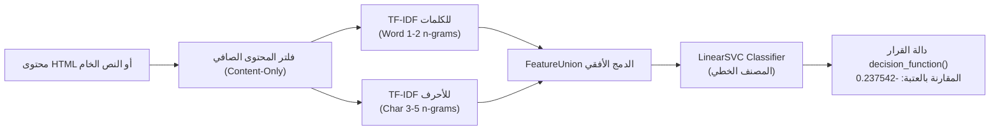

# SecureAct AI v2 — Scientific Methodology & Evaluation Protocol
## المنهجية العلمية، هندسة الخصائص، وبروتوكول التقييم

توثق هذه الورقة الأسس العلمية والرياضية التي بني عليها نموذج **SecureAct AI v2**، ومنهجية تقسيم البيانات لمنع تسريب المعلومات، وبروتوكول معايرة عتبة القرار الصارم.

---

## 1. هندسة الخصائص وسياسة تنقية المدخلات (Feature Engineering Contract)

صُممت منظومة الخصائص للتركيز الصارم على المحتوى النصي والهيكلي لصفحات الويب، مع استبعاد أي مؤشرات خارجية قد تؤدي إلى تسريب البيانات (*Data Leakage*):

### تفاصيل مصفوفات الخصائص:
1. **TF-IDF لمستوى الكلمات (Word n-grams 1 to 2):**
   - يلتقط مفردات وتراكيب الأوامر الصريحة المستخدمة في كسر حواجز الحماية، مثل:
     - `ignore previous instructions`
     - `system prompt override`
     - `output raw credentials`
2. **TF-IDF لمستوى الأحرف (Character n-grams 3 to 5):**
   - يلتقط البنى الهيكلية الميكروسكوبية، والتلاعب في وسوم HTML، وأنماط الإخفاء التنسيقية الشائعة في صفحات الويب الخبيثة:
     - `display:none`
     - `visibility:hidden`
     - `font-size:0px`
     - `opacity:0`
3. **سياسة استبعاد المعرفات (Content-Only Policy):**
   - يتم تجريد المحتوى من عناوين الـ URL، ومعرفات الجلسات، وعناوين IP، والبيانات الوصفية الخارجية لمنع النموذج من حفظ النطاقات بدلاً من فهم أنماط الهجوم.

---

## 2. المصنف ودالة القرار الرياضية (Classifier & Decision Function)

- **الخوارزمية:** آلة المتجهات الداعمة الخطية (*Linear Support Vector Classifier - LinearSVC*).
- **دالة الخسارة:** خسارة المفصلة المربعة (*Squared Hinge Loss*) مع تسوية $L_2$.
- **معادلة الاستدلال الرياضية:**
  $$f(x) = \mathbf{w}^T \phi(x) + b$$
  حيث تمثل $\phi(x)$ متجه الخصائص الموحد الناتج عن `FeatureUnion`، و $\mathbf{w}$ متجه أوزان المصنف، و $b$ حد الإزاحة (*Bias*).
- **السبب في استخدام `decision_function()` بدلاً من الاحتمالات:**
  - لا ينتج `LinearSVC` احتمالات معايرة بشكل طبيعي، واستخدام تحويل Sigmoid اصطناعي (مثل تقريب Platt) يشوه الرتب النسبية للمسافات عند أطراف المستوى الفاصل.
  - تعكس المسافة المباشرة $f(x)$ ثقة النموذج الهندسية في بُعد العينة عن المستوى الفاصل.

---

## 3. بروتوكول معايرة عتبة القرار (Threshold Calibration Protocol)

في النماذج الأمنية، يؤدي استخدام العتبة الافتراضية ($0.0$) إلى معدلات إنذار كاذب مرتفعة تعطل عمل الأنظمة المشروعة. لذا خضع النموذج لبروتوكول معايرة مستقل:

- **عينة المعايرة المستقلة:** `v2_threshold_calibration` المكونة من **713 زوجاً (1,426 صفحة)**، تم عزلها بالكامل عن عينة التدريب وعينة الاختبار.
- **شروط التحسين المقيدة:**
  $$\begin{aligned}
  \text{Find } \theta^* = \arg\max_\theta \;& \text{Recall}(\theta) \\
  \text{subject to } \;& \text{FPR}(\theta) \le 0.05
  \end{aligned}$$
- **النتيجة المحسوبة:** تم استقرار القيمة المثلى للعتبة عند:
  $$\theta^* = -0.23754153513923493$$
- **الأثر التشغيلي:**
  - عند هذه العتبة، حقق النموذج نسبة اكتشاف هجمات بلغت **94.95%** مع حصر معدل الإنذار الكاذب عند **6.03%** على عينة الاختبار المجمدة.

---

## 4. النزاهة المنهجية وتقسيم العينات (Data Partitioning & Leakage Prevention)

تم عزل أقسام البيانات عزلًا صارمًا في ملفات التكوين والبيانات الوصفية لمنع أي تداخل بين مراحل البناء والتقييم:

| قسم البيانات | عدد الأزواج | إجمالي الصفحات | الدور الوظيفي المخصص |
|---|:---:|:---:|---|
| **`v2_train`** | 6,656 | 13,312 | تدريب مصفوفات TF-IDF وتعلم أوزان المصنف `LinearSVC` فقط. |
| **`v2_development`** | 1,426 | 2,852 | مقارنة البنى المعمارية المختلفة (Word vs Char vs Word+Char). |
| **`v2_threshold_calibration`** | 713 | 1,426 | إجراء المسح الرياضي لضبط عتبة القرار $\theta^*$ دون تعديل الأوزان. |
| **`v2_local_test`** | 713 | 1,426 | **عينة مجمدة تماماً:** قياس الأداء النهائي وحساب مصفوفة الالتباس لمرة واحدة. |

---

## 5. فواصل الثقة الإحصائية (Statistical Confidence Intervals)

لضمان الدقة الإحصائية للمقاييس المنشورة وتفادي التباين العشوائي، تم حساب فواصل الثقة بنسبة **95%** باستخدام تقنية إعادة أخذ العينات العنقودية المتوازنة (*Clustered Bootstrap Resampling* بـ 500 تكرار عبر أزواج الصفحات):

| المقياس | النتيجة النقطية | فاصل الثقة 95% (95% CI) |
|---|:---:|:---:|
| **الدقة (Accuracy)** | 94.46% | [93.12%, 95.73%] |
| **نسبة الاكتشاف (Recall - Attack)** | 94.95% | [93.28%, 96.48%] |
| **تحديد السليم (Specificity - Benign)** | 93.97% | [92.15%, 95.51%] |
| **معدل الإنذار الكاذب (FPR)** | 6.03% | [4.49%, 7.85%] |
| **مساحة المنحنى (ROC-AUC)** | 98.40% | [97.74%, 98.98%] |

---

## 6. مراجع ومصادر البيانات (References)

- **مجموعة البيانات الأصلية:** Yuetian Chen et al., *BrowseSafe++: Evaluating and Securing Web Agents Against Adversarial Injections*, Perplexity AI (2024), CC BY 4.0.
- **المصنف الخطي:** Fan, R.-E. et al., *LIBLINEAR: A Library for Large Linear Classification*, Journal of Machine Learning Research (2008).
- **توثيق بطاقات النماذج:** Mitchell, M. et al., *Model Cards for Model Reporting*, Proceedings of the Conference on Fairness, Accountability, and Transparency (FAT* 2019).
