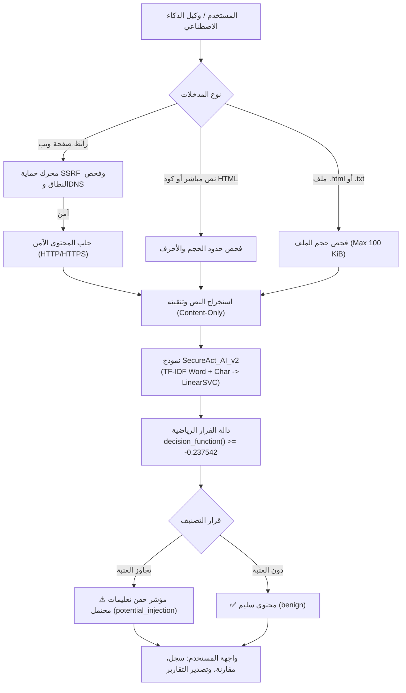

# SecureAct AI Platform (v2.0)
## منصة الكشف الاستباقي عن محاولات حقن التعليمات في صفحات الويب ومستندات HTML
### Production-Grade AI Platform for Web Prompt Injection Detection

---

## 🌐 روابط الوصول السريع (Quick Links & Live Platform)

- **المنصة الحية على Vercel:** [https://secureact-ai-platform.vercel.app](https://secureact-ai-platform.vercel.app) *(سيتم تحديث الرابط فور اكتمال النشر)*
- **مستودع الكود المصدري:** [https://github.com/Mazenalodini/SecureAct-AI-Platform](https://github.com/Mazenalodini/SecureAct-AI-Platform)
- **البطاقة الفنية للنموذج:** [`MODEL_CARD.md`](MODEL_CARD.md)
- **المنهجية العلمية والتقييم الإحصائي:** [`METHODOLOGY.md`](METHODOLOGY.md)
- **السياسة الأمنية وضوابط SSRF:** [`SECURITY.md`](SECURITY.md)
- **دليل العرض التوضيحي للأستاذ:** [`DEMO_GUIDE_AR.md`](DEMO_GUIDE_AR.md)

---

## 1. نبذة عن المنصة (Overview)

**SecureAct AI** هي منصة أمنية متكاملة مدعومة بالذكاء الاصطناعي، تهدف إلى الكشف الاستباقي عن محاولات **حقن التعليمات غير المباشر (*Indirect Prompt Injection*)** في صفحات الويب، ومستندات HTML، والنصوص المدخلة لوكلاء الذكاء الاصطناعي (*AI Web Agents*).

المشروع ليس مجرد نموذج تعلم آلي معزول أو موقع لعرض المقاييس، بل هو **منتج ويب متكامل وعملي** يدمج بين مصنف خطي فائق السرعة (`LinearSVC` مع مصفوفات TF-IDF مزدوجة) ومحرك حماية شبكي متقدم يمنع ثغرات تزوير الطلبات من جانب الخادم (*SSRF*)، مع واجهة مستخدم احترافية تدعم اللغتين العربية والإنجليزية واتجاهي RTL وLTR بالكامل.



---

## 2. الوظائف والميزات الحية للمنتج (Key Features)

### 1. فاحص الروابط الآمن (Safe Web URL Scanner)
- جلب صفحات الويب العامة وفحص محتواها الحقيقي لحظياً.
- **محرك حماية SSRF متقدم:** فحص DNS مسبق، حظر العناوين الخاصة والشبكات المحلية وعناوين السحابة الحساسة (مثل `169.254.169.254`)، ومراقبة المهل والتحويلات اليدوية (حد أقصى 3 تحويلات).
- **تدقيق مراحل الفحص الأربعة:** تفصيل بصري لحالة كل مرحلة: (1) فحص النطاق وSSRF، (2) اتصال وجلب الشبكة، (3) استخراج المحتوى، (4) استدلال الذكاء الاصطناعي.
- **فصل دقيق للأخطاء:** تمييز واضح بين تعذر إيجاد النطاق (`dns_error`)، وانتهاء المهلة (`connect_timeout`)، والحظر الأمني الحقيقي (`ssrf_blocked`).

### 2. الفحص الجماعي للروابط (Batch URL Scanner)
- فحص ما يصل إلى **10 روابط ويب** في دفعة واحدة.
- تحكم صارم بالتزامن (حد أقصى 3 عمليات جلب متوازية) لمنع استنزاف الموارد.
- **عزل تام للإخفاقات:** فشل أو حظر أي رابط لا يوقف ولا يؤثر على سلامة فحص الروابط الأخرى في الدفعة.

### 3. التحليل المباشر ورفع الملفات (Direct Content & File Analysis)
- فحص نصوص وشفرات HTML مباشرة حتى **100,000 حرف Unicode**.
- دعم رفع ملفات `.html` و`.txt` حتى **100 KiB** مع رفض تلقائي للامتدادات غير المدعومة برمز `HTTP 400`.
- أزرار سريعة (*Presets*) لاختبار سيناريوهات واقعية: (مقال تقني سليم، هجوم تجاوز صريح، هجوم وسوم مخفية `display:none`).

### 4. سجل الفحوصات والمقارنة والتقارير (History, Comparison & Reports)
- **أرشفة محلية في المتصفح:** حفظ سجل الفحوصات في `localStorage` مع الحفاظ التام على الخصوصية (تخزين 80 حرفاً فقط كمعرّف وعدم حفظ صفحات الويب الكاملة).
- **المقارنة الجانبية (Side-by-Side Compare):** اختيار فحصين من السجل وعرض مقارنة مباشرة لدرجات القرار وهامش العتبة وأزمنة الاستجابة.
- **تصدير التقارير:** نسخ ملخص الفحص الفوري للحافظة، تنزيل تقرير تقني مفصل بتنسيق `JSON`، وتنسيق مخصص للطباعة والحفظ كملف `PDF` عبر `@media print`.

### 5. واجهة مستخدم ثنائية اللغة وتجاوب كامل (Bilingual & Responsive UI)
- واجهة احترافية داكنة (*Glassmorphic Theme*) مبنية على خط `Tajawal` العربي الافتراضي مع دعم اتجاه `RTL` بالكامل.
- تبديل لحظي للغة الإنجليزية واتجاه `LTR` بنقرة واحدة.
- تصميم متجاوب 100% مع الشاشات الصغيرة والهواتف الذكية (بعرض يبدأ من 400px) وقائمة مخصصة للهواتف.

---

## 3. المعمارية الفنية ومواصفات النموذج (Model Architecture)

| البند | البيان الفني المعتمد |
|---|---|
| **اسم النموذج** | `SecureAct_AI_v2` (المعرف: `html_word_char_linear_svc`) |
| **المصنف الأساسي** | Linear Support Vector Classifier (`LinearSVC`) |
| **استخراج الخصائص** | `FeatureUnion` مدمج لمصفوفتين TF-IDF: <br>• **كلمات (Word 1-2 n-grams):** رصد أوامر التجاوز الصريحة. <br>• **أحرف (Char 3-5 n-grams):** رصد وسوم HTML المخفية مثل `display:none`. |
| **دالة الاستدلال** | دالة المسافة الخطية المباشرة `decision_function([content])` |
| **عتبة القرار التشغيلية** | **`-0.23754153513923493`** (معايرة رياضياً على عينة مستقلة لاستهداف FPR <= 5%) |
| **بصمة SHA-256 للنموذج** | `8569185d875a1bd76768e1a576c1cfcfd8ff6d74529cd5e646f67d610f2ece5c` |
| **حجم ملف النموذج** | **2.6 ميجابايت** بتنسيق Joblib (مضمن في المستودع لتمكين التشغيل الذاتي) |
| **مجموعة بيانات التدريب** | `perplexity-ai/browsesafe-plus-plus` (ترخيص CC BY 4.0 من Perplexity AI) |
| **حجم عينة التدريب** | 6,656 زوجاً متوازناً (**13,312 صفحة**) |

---

## 4. المقاييس المرجعية المعتمدة (Evaluation Benchmarks)

نتائج التقييم المستخرجة من عينة الاختبار المحلية المجمدة `v2_local_test` المكونة من **1,426 صفحة (713 زوجاً متوازناً)**:

| المقياس | النتيجة لـ SecureAct AI v2 | خط الأساس للنموذج v1 | مقارنة الأداء |
|---|:---:|:---:|:---:|
| **الدقة الإجمالية (Accuracy)** | **94.46%** | 83.20% | **+11.26%** |
| **الدقة التنبؤية (Precision)** | **94.03%** | 83.65% | **+10.38%** |
| **نسبة الاكتشاف (Recall - Attack)** | **94.95%** | 82.54% | **+12.41%** |
| **معيار F1 المرجح (F1 Score)** | **94.49%** | 83.09% | **+11.40%** |
| **تحديد السليم (Specificity - Benign)** | **93.97%** | 83.87% | **+10.10%** |
| **معدل الإنذار الكاذب (False Positive Rate)** | **6.03%** | 16.13% | **-10.10%** (انخفاض ممتاز) |
| **المساحة تحت المنحنى (ROC-AUC)** | **98.40%** | 90.93% | **+7.47%** |
| **متوسط الدقة (Average Precision / PR-AUC)** | **98.65%** | 92.19% | **+6.46%** |

### مصفوفة الالتباس (Confusion Matrix):
- **سليم مؤكد (True Negative):** 670 صفحة
- **إنذار كاذب (False Positive):** 43 صفحة (FPR: 6.03%)
- **هجوم غير مكتشف (False Negative):** 36 صفحة (Miss Rate: 5.05%)
- **هجوم مكتشف (True Positive):** 677 صفحة (Recall: 94.95%)

---

## 5. ضوابط الأمان والخصوصية (Security Controls & Privacy)

| الضابط الهندسي | الحد المسموح | السلوك عند التجاوز |
|---|---|---|
| **حجم طلب HTTP كاملاً** | **1 MiB** (1,048,576 بايت) | رفض فوري برمز **HTTP 413 Payload Too Large** |
| **حجم الملف المرفوع** | **100 KiB** (102,400 بايت) | رفض فوري برمز **HTTP 413 Payload Too Large** |
| **طول النص بعد فك الترميز** | **100,000 حرف Unicode** | رفض برمز **HTTP 400 Bad Request** مع إظهار الطول الفعلي |
| **أنواع الملفات المدعومة** | `.html` و `.txt` فقط | رفض الأنواع الأخرى برمز **HTTP 400** (`invalid_file_type`) |
| **تحديد معدل الطلبات** | **30 طلباً في الدقيقة** لكل IP | حظر مؤقت برمز **HTTP 429 Too Many Requests** مع ترويسة `Retry-After` |
| **حماية نزاهة النموذج التشفيرية** | فحص SHA-256 إلزامي عند الإقلاع | إيقاف الخادم وإرجاع **HTTP 503** في حال حدوث أي تلاعب بالملف |
| **سياسة الخصوصية الصفرية** | عدم تخزين أي نصوص في الخادم | عدم تسجيل أي محتوى مستخدم في الـ Logs لتفادي تسريب البيانات |

---

## 6. خطوات التشغيل المحلي (Local Quickstart)

### المتطلبات الأساسية (Prerequisites):
- **Python 3.10+** (تم الاختبار والتطوير على Python 3.12 و 3.14).
- **Node.js 18+** مع مدير الحزم `npm`.

### أ. تشغيل خادم الواجهة البرمجية (FastAPI Backend):

#### على أنظمة Linux و macOS:
```bash
# 1. الدخول إلى مجلد المشروع
cd SecureAct-AI-Platform

# 2. إنشاء وتفعيل البيئة الوهمية
python3 -m venv .venv
source .venv/bin/activate

# 3. تثبيت الاعتماديات
pip install -r requirements.txt

# 4. تشغيل الخادم
uvicorn backend.app.main:app --host 127.0.0.1 --port 8000 --reload
```

#### على نظام Windows (PowerShell):
```powershell
# 1. الدخول إلى مجلد المشروع
cd SecureAct-AI-Platform

# 2. إنشاء وتفعيل البيئة الوهمية
python -m venv .venv
.\.venv\Scripts\Activate.ps1

# 3. تثبيت الاعتماديات
pip install -r requirements.txt

# 4. تشغيل الخادم
python -m uvicorn backend.app.main:app --host 127.0.0.1 --port 8000 --reload
```

- يعمل الخادم محلياً على: `http://127.0.0.1:8000`
- وثائق Swagger التفاعلية: `http://127.0.0.1:8000/docs`
- فحص جاهزية النظام: `http://127.0.0.1:8000/health`

### ب. تشغيل الواجهة الأمامية (React + Vite):

```bash
# 1. الانتقال لمجلد الواجهة
cd frontend

# 2. تثبيت حزم npm
npm install

# 3. تشغيل خادم التطوير
npm run dev
```
- ستعمل الواجهة التفاعلية على: `http://127.0.0.1:5173` (مع ربط وكيل تلقائي لخادم الـ API عبر Vite Proxy).

---

## 7. الاختبارات الآلية المعتمدة (Automated Testing)

المشروع مزود بحزمة اختبارات آلية شاملة تغطي النموذج، والتحقق من المدخلات، وحدود الأمان، وحماية SSRF، وفحص الروابط:

```bash
# تشغيل كامل حزمة اختبارات الخادم عبر pytest
pytest tests/ -v
```

**النتيجة الفعلية للاختبارات:**
- **36 اختباراً ناجحاً بنسبة 100%** (36 passed في 42.89 ثانية).
- يشمل ذلك اختبارات حظر SSRF لشبكات الـ Loopback، وعناوين السحابة الخاصة، والمنافذ غير المصرح بها، وفصل أخطاء DNS، وفحص حجم الملفات والطلبات.

```bash
# التحقق من بناء الواجهة الأمامية للإنتاج
cd frontend && npm run build
```
- بناء نظيف وناجح بالكامل عبر `tsc && vite build` دون أي أخطاء في الأنواع أو الحزم.

---

## 8. بنية مجلدات المشروع (Repository Structure)

```text
SecureAct-AI-Platform/
├── api/
│   ├── index.py                 # نقطة الدخول لدوال Vercel السحابية (Serverless Entrypoint)
│   └── requirements.txt         # اعتماديات بيئة Vercel
├── backend/
│   ├── app/
│   │   ├── config.py            # الثوابت، المهل، والحدود التشغيلية
│   │   ├── demo_data.py         # الحالات التجريبية الميدانية النموذجية
│   │   ├── main.py              # مسارات FastAPI وإعدادات CORS والمصادقة
│   │   ├── middleware.py        # طبقات حظر الحجم الزائد (1 MiB) ومحدد الطلبات (Rate Limiter)
│   │   ├── model_service.py     # خدمة Singleton للتحقق من SHA-256 والاستدلال بـ LinearSVC
│   │   ├── schemas.py           # مخططات البيانات والتحقق (Pydantic v2 Models)
│   │   └── url_scanner.py       # محرك فحص الروابط وحماية SSRF وفحص DNS
│   └── requirements.txt         # اعتماديات الخادم المحلي
├── frontend/
│   ├── src/
│   │   ├── components/          # المكونات المشتركة (Navbar, Footer, MetricCard, ConfusionMatrix)
│   │   ├── context/             # سياق إدارة اللغة واتجاه العرض (LanguageContext: ar/en)
│   │   ├── locales/             # قواميس الترجمة الكاملة (translations.ts)
│   │   ├── pages/               # صفحات المنصة (ScanWorkspace, HistoryPage, DemoCases, Methodology)
│   │   ├── services/            # عميل الاتصال بالـ API (api.ts)
│   │   └── types/               # تعريفات TypeScript للبيانات
│   ├── index.html               # القالب الرئيسي للواجهة
│   ├── package.json             # اعتماديات React وVite
│   └── vite.config.ts           # إعدادات Vite وموجه Proxy المحلي
├── models/
│   ├── local_test_metrics.json  # المقاييس المرجعية المسجلة لعينة الاختبار
│   ├── model_metadata.json      # البيانات الوصفية وهندسة الخصائص
│   ├── secureact_ai_v2_model.joblib # ملف النموذج المعتمد الحقيقي (2.6 MB)
│   └── training_summary.json    # ملخص تدريب v2 ومقارنة خط الأساس v1
├── tests/
│   ├── test_api.py              # اختبارات تكامل نهايات الـ API
│   ├── test_model.py            # اختبارات نزاهة النموذج والاستدلال ودالة القرار
│   ├── test_url_scanner.py      # اختبارات محرك فحص الروابط وSSRF وحالات الأخطاء
│   └── test_validation.py       # اختبارات حدود الأحرف والأحجام وأنواع الملفات
├── .env.example                 # نموذج إعداد متغيرات البيئة (خالٍ من الأسرار)
├── .gitignore                   # استبعاد البيئات الوهمية والأرشيفات ومخرجات البناء
├── DEMO_GUIDE_AR.md             # دليل العرض التوضيحي للأستاذ ولجنة التقييم
├── METHODOLOGY.md               # تفاصيل المنهجية العلمية والرياضية
├── MODEL_CARD.md                # البطاقة الفنية الرسمية للنموذج
├── package.json                 # سكريبتات المشروع العامة المتوافقة عبر الأنظمة
├── README.md                    # وثيقة التوثيق الرئيسية للمشروع
├── requirements.txt             # اعتماديات الإنتاج الرئيسية في الجذر
├── SECURITY.md                  # السياسة الأمنية وضوابط الحماية من SSRF
└── vercel.json                  # إعدادات النشر السحابي وتوجيه الدوال في Vercel
```

---

## 9. نقاط النهاية البرمجية (API Reference)

| المسار | الطريقة | الوصف الوظيفي |
|---|:---:|---|
| `/health` | `GET` | فحص جاهزية النظام، تحميل النموذج، والتحقق من بصمة SHA-256 |
| `/api/model-info` | `GET` | استرجاع البيانات الوصفية، معمارية الخصائص، وبيئة التدريب |
| `/api/metrics` | `GET` | استرجاع المقاييس المرجعية المعتمدة لعينة الاختبار ومصفوفة الالتباس |
| `/api/predict` | `POST` | فحص محتوى نصي أو كود HTML واستخراج درجة القرار وتصنيف الحقن |
| `/api/predict/file` | `POST` | فحص ملف مرفوع بصيغة `.html` أو `.txt` (حتى 100 KiB) |
| `/api/scan-url` | `POST` | جلب وفحص صفحة ويب فردية بأمان تام مع تطبيق دفاعات SSRF |
| `/api/scan-batch` | `POST` | فحص جماعي لما يصل إلى 10 روابط بالتوازي مع عزل الأخطاء |
| `/api/demo/cases` | `GET` | استرجاع الحالات التجريبية الميدانية الست المعتمدة |
| `/api/demo/batch` | `POST` | تنفيذ الاستدلال الحي على كافة الحالات التجريبية وحساب الدقة الآنية |

---

## 10. الوضع القانوني وحقوق الاستخدام (Licensing & Attribution)

- **ملف النموذج المدرب (`models/secureact_ai_v2_model.joblib`):**
  - مُدرج ضمن المستودع بموافقة صريحة من مالك المشروع لتمكين النشر والتشغيل المباشر لأغراض التقييم الأكاديمي.
  - إدراجه في مستودع عام يجعله قابلاً للتنزيل العام، ولا يمثل ذلك حسماً نهائياً لحقوق إعادة التوزيع التجاري المستقلة.
- **إسناد بيانات التدريب:**
  - دُرّب النموذج على مجموعة بيانات `BrowseSafe++` المنشورة بواسطة Perplexity AI بموجب ترخيص المشاع الإبداعي النسبي (**Creative Commons Attribution 4.0 International - CC BY 4.0**).
- **المكتبات مفتوحة المصدر:**
  - يعتمد المشروع على مكتبة `scikit-learn` المرخصة برخصة BSD-3-Clause، وإطار `FastAPI` المرخص برخصة MIT.
- **كود المشروع:**
  - الكود المصدري متاح للاطلاع والمراجعة الأكاديمية والبحثية، وتخضع أي تراخيص تجارية لاحقة لقرار مالك المشروع.

---

## 11. تنبيه أمني وأخلاقي (Academic & Safety Disclaimer)

> [!WARNING]
> نموذج **SecureAct AI v2** هو أداة أمنية بحثية متقدمة مبنية على تحليل الأنماط المظهرية والسطحية للنصوص وHTML (عبر TF-IDF و LinearSVC).
> - **النموذج لا يقدم ضماناً أمنياً مطلقاً بنسبة 100%:** يسجل النموذج معدل إنذار كاذب قدره **6.03%** على عينة التقييم المحلية، وقد يصنف بعض النصوص التقنية السليمة كاشتباه.
> - **الدفاع في العمق:** يجب استخدام هذا المصنف كطبقة تصفية أولية سريعة وخفيفة ضمن منظومة دفاعية متعددة الطبقات (*Defense-in-Depth*)، وعدم الاعتماد عليه كحاجز حماية وحيد للأنظمة الحساسة.

---

## 12. ملخص تنفيذي بالإنجليزية (Executive English Summary)

### SecureAct AI Platform v2
**SecureAct AI** is a production-grade, open-source security platform engineered for preemptive detection of **Prompt Injection** threats hidden within web pages, HTML documents, and untrusted inputs targeting LLM web agents.

- **Machine Learning Core:** `LinearSVC` with dual `FeatureUnion` TF-IDF extractors (Word n-grams 1–2 and Character n-grams 3–5).
- **Calibrated Threshold:** $-0.23754153513923493$ optimized on an independent calibration split targeting $\text{FPR} \le 5\%$.
- **Verified Benchmark Performance:** **94.46% Accuracy**, **94.95% Recall (Attack detection)**, **6.03% False Positive Rate**, and **98.40% ROC-AUC** on the frozen `v2_local_test` benchmark partition (1,426 pages).
- **Built-in SSRF Protection:** Pre-connect DNS resolution, strict IP network blacklisting (loopback, private, link-local, cloud metadata `169.254.169.254`), controlled redirect following, and distinct network error handling.
- **Zero-Retention Architecture:** No persistent storage of full user documents or retrieved HTML; client-side lightweight inspection history in `localStorage`.
- **Live Deployment Stack:** Ready for serverless deployment on **Vercel** (`api/index.py` FastAPI ASGI serverless handler + Vite React static frontend).
