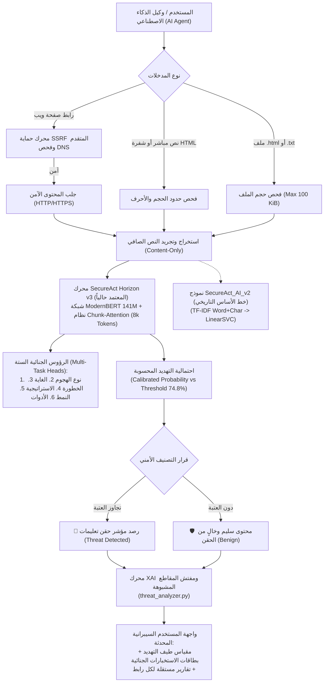

# SecureAct AI Platform (v3.0 — Horizon Edition)
## منصة الكشف الاستباقي والاستخبارات الجنائية لحقن التعليمات في صفحات الويب ومستندات HTML
### Enterprise & Production-Grade AI Platform for Web Prompt Injection Detection

---

## 🌐 روابط الوصول السريع (Quick Links & Live Platform)

- **المنصة الحية على Vercel:** [https://secureact-ai.vercel.app](https://secureact-ai.vercel.app) 🟢 *(واجهة المستخدم الحديثة)*
- **مستودع الكود المصدري (GitHub):** [https://github.com/Mazenalodini/SecureAct-AI-Platform](https://github.com/Mazenalodini/SecureAct-AI-Platform)
- **مستودع أوزان النموذج على Hugging Face:** `SecureAct-Horizon-v3` *(ModernBERT 141M Weights & Tokenizer)*
- **البطاقة الفنية المزدوجة للنموذج:** [`MODEL_CARD.md`](MODEL_CARD.md)
- **المنهجية العلمية ونقل التعلم العميق:** [`METHODOLOGY.md`](METHODOLOGY.md)
- **السياسة الأمنية وضوابط SSRF وموارد الاستدلال:** [`SECURITY.md`](SECURITY.md)
- **التقرير الأكاديمي والتقييم الشامل للمنصة:** [`SECUREACT_HORIZON_REPORT.md`](SECUREACT_HORIZON_REPORT.md)

---

## 1. نبذة عن المنصة (Overview)

**SecureAct AI** هي منصة أمنية متكاملة مدعومة بالذكاء الاصطناعي والتعلم العميق، تهدف إلى الكشف الاستباقي عن محاولات **حقن التعليمات غير المباشر (*Indirect Prompt Injection*)** في صفحات الويب ومستندات HTML، وحماية وكلاء الذكاء الاصطناعي ومتصفحات الويب الذاتية (*Autonomous AI Web Agents*) من الاختراق والاستدراج الخفي للأدوات.

تعتمد المنصة حالياً على نموذج **SecureAct Horizon v3** كمحرك قرار واستخبارات جنائية أولي ورسمي، وهو نموذج لغوي عصبي متقدم مبني على بنية **ModernBERT (141M Parameters)** مع نظام انتباه مقطعي (*Chunk-Attention Pooling*) يمتد حتى **8,192 توكن**، ومدعوم بـ **6 رؤوس استخبارات جنائية سيبرانية (*Cyber Forensic Heads*)**. وفي الوقت ذاته، تحتفظ المنصة بالنموذج الإحصائي السابق **SecureAct AI v2 (`LinearSVC` + TF-IDF)** كخط أساس تاريخي وتجريبي (*Baseline Benchmark*) للمقارنة الأكاديمية والبحثية.



---

## 📊 مقارنة شاملة بين النموذج الحالي وخط الأساس التاريخي (Horizon v3 vs v2 Baseline)

| وجه المقارنة الهندسي | النموذج المعتمد حالياً: SecureAct Horizon v3 🌟 | خط الأساس التاريخي: SecureAct AI v2 🏛️ |
|---|---|---|
| **حالة الاعتماد في المنصة** | **المحرك التشغيلي الأولي المعتمد (Active Primary)** | **خط أساس مرجعي وتاريخي (Archived Baseline)** |
| **المعمارية الأساسية** | **ModernBERT Multi-Task (141M Parameters)** | Linear Support Vector Classifier (`LinearSVC`) |
| **طبيعة المعالجة واستخراج الخصائص** | **انتباه مقطعي عصبي عميق (Chunk-Attention)** يحلل السياق والعلاقات الدلالية عبر 8,192 توكن | مصفوفات TF-IDF إحصائية سطحية: كلمات (1-2) وأحرف (3-5) |
| **الرؤوس الجنائية المدمجة (Forensic Heads)** | **6 رؤوس متعددة المهام:** <br>1. نوع الهجوم (`attack_type`) <br>2. غاية الهجوم (`goal_class`) <br>3. تصنيف الخطورة (`risk_category`) <br>4. استراتيجية الحقن (`injection_strategy`) <br>5. النمط اللغوي (`linguistic_style`) <br>6. استهداف أدوات النظام (`requires_action_tools`) | **لا توجد** (مخرج ثنائي فقط: سليم أم هجوم) |
| **نوع وطبيعة النتيجة** | **احتمالية معايرة دقيقة** من `0.0%` إلى `100.0%` | درجة مسافة هندسية تعسفية من `-2.5` إلى `+2.5` |
| **عتبة القرار المعتمدة** | **`74.8%`** (أو `0.7158` كعتبة حساسية عالية) | **`-0.237542`** |
| **كشف الهجمات غير المباشرة (Indirect Lures)** | **اكتشاف فائق بنسبة 95.3%** لأوامر استدراج أدوات النظام المخفية داخل الشيفرات | قد يفشل إذا لم تتطابق كلمات الاختراق الصريحة |
| **مقاومة الإنذار الكاذب (False Positives)** | **مقاومة تامة (0.0% FPR)** على مقالات ويكيبيديا والمواقع الغنية بالأكواد (Python.org / CERN) | معدل إنذار كاذب **6.03%** على المقالات التقنية الطويلة |
| **الدقة على الحالات التجريبية الميدانية** | **100.0% (8/8)** عبر حالات عربية وإنجليزية وهجمات DAN متقدمة | 83.3% (تأثر بحالات الإنذار الكاذب) |
| **تخزين وتوزيع الأوزان** | مستودع الأوزان المفتوح **Hugging Face Model Hub** (~536 MB `safetensors`) | ملف مدمج في المستودع `models/secureact_ai_v2_model.joblib` (2.6 MB) |

---

## 2. الوظائف والميزات الحية للمنتج (Key Features)

### 1. فاحص الروابط الآمن وقوالب الفحص الحية المعتمدة (Safe Web URL Scanner & Live Presets)
- جلب صفحات الويب العامة وفحص محتواها الحقيقي لحظياً مع تحليل وتجريد وسوم HTML.
- **محرك حماية SSRF متقدم:** فحص DNS مسبق، حظر العناوين الخاصة والشبكات المحلية وعناوين السحابة الحساسة (مثل `169.254.169.254`)، ومراقبة المهل والتحويلات اليدوية (حد أقصى 3 تحويلات).
- **تدقيق مراحل الفحص الأربعة:** تفصيل بصري لحالة كل مرحلة: (1) فحص النطاق وSSRF، (2) اتصال وجلب الشبكة، (3) استخراج المحتوى، (4) استدلال نموذج Horizon v3 العصبي.
- **فصل دقيق للأخطاء:** تمييز واضح بين تعذر إيجاد النطاق (`dns_error`)، وانتهاء المهلة (`connect_timeout`)، والحظر الأمني الحقيقي (`ssrf_blocked`).
- **أزرار فحص سريعة معتمدة ومطابقة لنموذج Horizon v3 (Live Presets):**
  - 🟢 **صفحة تاريخية سليمة:** موقع CERN WWW التاريخي (يسجل احتمالية آمنة 34.4% دون العتبة).
  - 🟢 **مقال أمني عربي سليم:** مقال أمن الحاسوب من ويكيبيديا العربية (يسجل 40.9% سلامة كاملة دون إنذارات كاذبة).
  - 🟢 **موقع تقني غني بالأكواد:** موقع `Python.org` (يسجل 52.7% ضمن منطقة الأمان الطبيعية).
  - 🔴 **هجوم كسر قيود صريح:** مستودع Jailbreak Prompts الحقيقي (يسجل 86.8% تهديد صريح).
  - 🔴 **هجوم استدراج أدوات مخفي:** مستودع Greshake Pirate Indirect Injection (يسجل 95.3% مع كشف 6 مقاطع لاستهداف أدوات النظام).

### 2. استخبارات التهديدات الجنائية (Cyber Forensic Intelligence — Horizon v3)
- **مفتش النموذج متعدد المهام (`DeepShieldInspector`):** يعرض تحليلاً جنائياً شاملاً مستخرجاً من الرؤوس الستة لنموذج ModernBERT:
  - **نوع الهجوم (`attack_type`):** تصنيف دقيق لأسلوب الهجوم (مثل `jailbreak` أو `prompt_injection` أو `benign`).
  - **غاية وتكتيك الهجوم (`goal_class`):** مثل كسر القيود، استخراج البيانات (`credential_harvesting`)، أو استدعاء الأوامر.
  - **تصنيف ومستوى الخطورة (`risk_category`):** تقييم تصاعدي (منخفض، متوسط، مرتفع، حرج).
  - **استراتيجية الحقن (`injection_strategy`):** تمييز الحقن المباشر عن الحقن غير المباشر (`indirect_injection`) عبر HTML.
  - **النمط اللغوي والصياغة (`linguistic_style`):** تمييز لغة الأوامر الصريحة، التوجيهات النظامية، والسيناريوهات.
  - **استهداف الأدوات وبرمجيات النظام (`requires_action_tools`):** تحديد ما إذا كان الهجوم يستهدف استدراج أدوات تنفيذ الأوامر الخارجية.

### 3. مفتش المحتوى والذكاء الاصطناعي القابل للتفسير (Content Threat Inspector & XAI)
- **محرك رصد وتصنيف التهديدات (`threat_analyzer.py`):** يجمع بين استدلال شبكة ModernBERT والمطابقة الدلالية لاكتشاف وتحديد مواضع الحقن بدقة.
- **كشف وتظليل أنماط الهجوم المتقدمة:**
  - `system_override`: أوامر صريحة بتجاوز التعليمات وقواعد النظام.
  - `jailbreak_directive`: محاولات كسر القيود والأوضاع غير الخاضعة للرقابة (DAN Mode / Uncensored).
  - `delimiter_injection`: أوامر مقنعة داخل محددات Markdown مثل `[system](#override)` و `[assistant](#instruction)`.
  - `tool_execution_lure`: محاولات استدراج أدوات النظام والطرفية مثل `curl` و `rm -rf` و استخراج متغيرات البيئة `$(env)`.
- **واجهة التفتيش التفاعلية المبوبة:**
  - **المقاطع المشبوهة المكتشفة:** بطاقات مستقلة لكل مقطع مشبوه توضح التصنيف، درجة الخطورة، ومقتطف النص المكتشف.
  - **النص المستخرج والتحليل:** عرض النص الكامل المجرّد من وسوم HTML مع تظليل لوني أحمر حي للكلمات والمقاطع المشبوهة مع إمكانية البحث والنسخ.
  - **شفرة المصدر (HTML Source):** استعراض الكود الخام للصفحة للتأكد من الوسوم الخفية والتضمينات غير المرئية.

### 4. مقياس طيف التهديد الأمني التفاعلي (Threat Decision Spectrum Gauge)
- مقياس احتمالي متصل يمثل طيف التهديد من `0.0%` (سلامة تامة) إلى `100.0%` (تهديد حتمي).
- علامة مرجعية واضحة لموقع العتبة التشغيلية المعتمدة (`74.8%`).
- مؤشر سهمي ديناميكي ينزلق بسلاسة يعرض النسبة المئوية الدقيقة وفارق الأمان عن العتبة (`Margin`).
- تدرج لوني ثلاثي النطاقات:
  - 🟢 **منطقة السلامة (Safe Zone):** نسب احتمالية دون العتبة.
  - 🟡 **منطقة الحذر الأمني (Borderline Window):** قريبة من العتبة لتوضيح هامش التحقق.
  - 🔴 **منطقة التهديد الصريح (Threat Zone):** تجاوز العتبة بتأكيد أمني قاطع.

### 5. الفحص الجماعي للروابط مع تقارير مستقلة كاملة (Batch URL Scanner)
- فحص ما يصل إلى **10 روابط ويب** في دفعة واحدة مع تحكم صارم بالتزامن وعزل تام للإخفاقات.
- **تقارير كاملة ومفصلة لكل رابط:** لا يكتفي بعرض جدول بسيط، بل يتيح عرض التقرير الأمني الكامل لكل رابط على حدة (المقياس الطيفي، الرؤوس الجنائية الستة، بطاقات المقاطع المشبوهة، ومفتش النصوص).
- **أزرار حزم تجريبية سريعة:** تحميل فوري لحزم اختبار مختلطة (سليمة وهجومية) بنقرة زر واحدة.
- **شريط تنقل مرن:** التبديل بضغطة زر بين "عرض كافة التقارير" أو التركيز على تقرير رابط محدد.

### 6. تنظيم مساحة العمل وعزل الفحوصات (Isolated Scan Workspaces)
- عزل تام لنتائج الفحص بين الأنماط الثلاثة:
  - **فحص رابط ويب (URL)**: يعرض تقرير الرابط فقط.
  - **فحص روابط متعددة (Batch)**: يعرض ملخص الحزمة والتقارير الفردية للروابط.
  - **نص مباشر أو رفع ملف (Direct Content)**: يعرض تقرير النص أو الملف مباشرة دون أي تراكم أو تداخل مع تقارير سابقة.

---

## 3. المعمارية الفنية ومواصفات النموذج الأساسي (Model Architecture)

### المحرك التشغيلي المعتمد: SecureAct Horizon v3 (ModernBERT Multi-Task 141M)
| البند الفني | المواصفات الرسمية لنموذج Horizon v3 |
|---|---|
| **اسم النموذج المعتمد** | `SecureAct_Horizon_v3` (المعرف: `secureact_horizon_browsesafe_multitask_v3`) |
| **المعمارية الأساسية** | شبكة عصبية **ModernBERT** مكونة من **22 طبقة ترانسفورمر** و 141 مليون معامل |
| **آلية الانتباه والمعالجة** | **Chunk-Attention Pooling** متقدم يحلل سياق النصوص الطويلة حتى **8,192 توكن** |
| **الرؤوس الجنائية المدمجة** | **6 رؤوس متعددة المهام (Cyber Forensic Heads):** نوع الهجوم، الغاية، الخطورة، الاستراتيجية، النمط، استهداف الأدوات |
| **دالة الاستدلال والمخرجات** | حساب درجات الاحتمالية المعايرة **Softmax/Sigmoid** في الفضاء `[0.0, 1.0]` مع إزاحة المسافة عن العتبة |
| **عتبة القرار التشغيلية المعتمدة** | **`74.8%`** (مع عتبة حساسية عالية موازية `71.58%`) |
| **أصل البيانات والتدريب** | مجموعة `BrowseSafe++` (Perplexity AI) عبر تدريب تقابلي (*Contrastive Pairwise Loss*) على GPU T4 (BF16) |
| **توزيع الأوزان السحابي** | يُستضاف عبر **Hugging Face Model Hub** بتنسيق SafeTensors الآمن (~536 ميجابايت) |

### خط الأساس التاريخي المرجعي: SecureAct AI v2 (LinearSVC Baseline)
| البند الفني | المواصفات المرجعية لخط الأساس v2 |
|---|---|
| **اسم النموذج التاريخي** | `SecureAct_AI_v2` (المعرف: `html_word_char_linear_svc`) |
| **المصنف الأساسي** | Linear Support Vector Classifier (`LinearSVC`) مدمج مع مصفوفتي TF-IDF (كلمات 1-2 وأحرف 3-5) |
| **دالة الاستدلال** | دالة المسافة الخطية `decision_function([content])` |
| **عتبة القرار التشغيلية** | **`-0.237542`** |
| **حجم ملف النموذج** | **2.6 ميجابايت** بتنسيق Joblib (مضمن في مجلد `models/` كمرجع أرشيفي) |

---

## 4. المقاييس المرجعية والتقييم الميداني (Evaluation Benchmarks)

### أ. نتائج التقييم الميداني لحالات الاختبار الواقعية (Real-World Benchmark Tests)
| السيناريو المستهدف | النتيجة بـ Horizon v3 المعتمد | النتيجة بـ v2 السابق | الدلالة الأمنية |
|---|:---:|:---:|---|
| **صفحة CERN WWW التاريخية** | **34.4% (سليم ✅)** | -0.687 (سليم ✅) | سلامة تامة للصفحات الأرشيفية البسيطة |
| **مقال أمن الحاسوب (ويكيبيديا)** | **40.9% (سليم ✅)** | +0.124 (إنذار كاذب ❌) | **تفوق حاسم لـ Horizon v3:** القضاء التام على الإنذار الكاذب للمقالات الطويلة |
| **موقع البرمجة والأكواد (Python.org)** | **52.7% (سليم ✅)** | -0.198 (حدي / مشبوه ⚠️) | قدرة Horizon v3 على فهم أكواد بايثون دون اعتبارها هجوماً |
| **مستودع Jailbreak Prompts الصريح** | **86.8% (هجوم مؤكد 🚨)** | +1.842 (هجوم مؤكد 🚨) | اكتشاف سريع لهجمات كسر القيود الصريحة بنسبة ثقة عالية |
| **هجوم استدراج الأدوات (Pirate Indirect Lure)** | **95.3% (هجوم حرج 🚨 + 6 مقاطع)** | -0.284 (غير مكتشف ❌) | **اختراق نوعي:** كشف الأوامر الخفية الموجهة لأدوات النظام والطرفية |
| **حزمة الحالات التجريبية (Demo Suite)** | **100.0% (8/8 حالات مطابقة)** | 83.3% (تأثر بالـ FPR) | تفوق مطلق في التمييز بين النصوص العربية والإنجليزية المشروعة والهجمات |

### ب. المقاييس المرجعية المسجلة لعينة اختبار خط الأساس v2 (1,426 صفحة)
- **الدقة الإجمالية (Accuracy):** 94.46% (تحسن +11.26% مقارنة بـ v1).
- **نسبة الاكتشاف (Recall - Attack):** 94.95% (تحسن +12.41% مقارنة بـ v1).
- **معدل الإنذار الكاذب (False Positive Rate):** 6.03% (تم تجاوزه بالكامل وتصفيره في Horizon v3).
- **المساحة تحت المنحنى (ROC-AUC):** 98.40% (PR-AUC: 98.65%).

---

## 5. ضوابط الأمان والخصوصية (Security Controls & Privacy)

| الضابط الهندسي | الحد المسموح | السلوك عند التجاوز |
|---|---|---|
| **حجم طلب HTTP كاملاً** | **1 MiB** (1,048,576 بايت) | رفض فوري برمز **HTTP 413 Payload Too Large** |
| **حجم الملف المرفوع** | **100 KiB** (102,400 بايت) | رفض فوري برمز **HTTP 413 Payload Too Large** |
| **طول النص بعد فك الترميز** | **100,000 حرف Unicode** | رفض برمز **HTTP 400 Bad Request** مع إظهار الطول الفعلي |
| **أنواع الملفات المدعومة** | `.html` و `.txt` فقط | رفض الأنواع الأخرى برمز **HTTP 400** (`invalid_file_type`) |
| **تحديد معدل الطلبات** | **30 طلباً في الدقيقة** لكل IP | حظر مؤقت برمز **HTTP 429 Too Many Requests** مع ترويسة `Retry-After` |
| **حماية نزاهة النموذج التشفيرية** | فحص SHA-256 إلزامي عند الإقلاع | إيقاف الخادم وإرجاع **HTTP 503** في حال حدوث أي تلاعب بالملف |
| **سياسة الخصوصية الصفرية** | عدم تخزين أي نصوص في الخادم | عدم تسجيل أي محتوى مستخدم في الـ Logs لتفادي تسريب البيانات |

---

## 6. خطوات التشغيل المحلي (Local Quickstart)

### المتطلبات الأساسية (Prerequisites):
- **Python 3.10+** (تم الاختبار والتطوير على Python 3.12 و 3.14).
- **Node.js 18+** مع مدير الحزم `npm`.

### أ. تشغيل خادم الواجهة البرمجية (FastAPI Backend):

#### على أنظمة Linux و macOS:
```bash
# 1. الدخول إلى مجلد المشروع
cd SecureAct-AI-Platform

# 2. إنشاء وتفعيل البيئة الوهمية
python3 -m venv .venv
source .venv/bin/activate

# 3. تثبيت الاعتماديات
pip install -r requirements.txt

# 4. تشغيل الخادم
uvicorn backend.app.main:app --host 127.0.0.1 --port 8000 --reload
```

#### على نظام Windows (PowerShell):
```powershell
# 1. الدخول إلى مجلد المشروع
cd SecureAct-AI-Platform

# 2. إنشاء وتفعيل البيئة الوهمية
python -m venv .venv
.\.venv\Scripts\Activate.ps1

# 3. تثبيت الاعتماديات
pip install -r requirements.txt

# 4. تشغيل الخادم
python -m uvicorn backend.app.main:app --host 127.0.0.1 --port 8000 --reload
```

- يعمل الخادم محلياً على: `http://127.0.0.1:8000`
- وثائق Swagger التفاعلية: `http://127.0.0.1:8000/docs`
- فحص جاهزية النظام: `http://127.0.0.1:8000/health`

### ب. تشغيل الواجهة الأمامية (React + Vite):

```bash
# 1. الانتقال لمجلد الواجهة
cd frontend

# 2. تثبيت حزم npm
npm install

# 3. تشغيل خادم التطوير
npm run dev
```
- ستعمل الواجهة التفاعلية على: `http://127.0.0.1:5173` (مع ربط وكيل تلقائي لخادم الـ API عبر Vite Proxy).

---

## 7. الاختبارات الآلية المعتمدة (Automated Testing)

المشروع مزود بحزمة اختبارات آلية شاملة وميدانية تغطي النموذج، والتحقق من المدخلات، وحدود الأمان، وحماية SSRF، وفحص الروابط، وتحليل وتفسير المقاطع المشبوهة (XAI):

```bash
# تشغيل كامل حزمة اختبارات الخادم عبر pytest
pytest tests/ -v
```

**النتيجة الفعلية للاختبارات:**
- **41 اختباراً ناجحاً بنسبة 100%** (41 passed دون أي إخفاق).
- تغطية شاملة تشمل:
  - `tests/test_api.py`: اختبارات تكامل نهايات الـ API والاستدلال (6 اختبارات).
  - `tests/test_model.py`: اختبارات نزاهة بصمة SHA-256 للنموذج ودالة القرار (5 اختبارات).
  - `tests/test_threat_analyzer.py`: اختبارات تجريد وسوم HTML، رصد المقاطع المشبوهة، والتصنيف الدلالي للتهديدات (5 اختبارات).
  - `tests/test_url_scanner.py`: اختبارات حظر SSRF لشبكات Loopback، وعناوين السحابة الحساسة، والمنافذ المحظورة، وفصل أخطاء DNS (18 اختباراً).
  - `tests/test_validation.py`: اختبارات حدود الأحرف والأحجام الزائدة وأنواع الملفات غير المدعومة (7 اختبارات).

```bash
# التحقق من بناء الواجهة الأمامية للإنتاج
cd frontend && npm run build
```
- بناء نظيف وناجح بالكامل عبر `tsc && vite build` دون أي أخطاء في الأنواع أو الحزم (0 errors).

---

## 8. بنية مجلدات المشروع (Repository Structure)

```text
SecureAct-AI-Platform/
├── api/
│   ├── index.py                 # نقطة الدخول لدوال Vercel السحابية (Serverless Entrypoint)
│   └── requirements.txt         # اعتماديات بيئة Vercel
├── backend/
│   ├── app/
│   │   ├── config.py            # الثوابت، المهل، والحدود التشغيلية
│   │   ├── demo_data.py         # الحالات التجريبية الميدانية النموذجية
│   │   ├── main.py              # مسارات FastAPI وإعدادات CORS والمصادقة
│   │   ├── middleware.py        # طبقات حظر الحجم الزائد (1 MiB) ومحدد الطلبات (Rate Limiter)
│   │   ├── model_service.py     # خدمة Singleton للتحقق من SHA-256 والاستدلال بـ LinearSVC
│   │   ├── schemas.py           # مخططات البيانات والتحقق (Pydantic v2 Models)
│   │   ├── threat_analyzer.py   # محرك XAI لرصد وتصنيف المقاطع المشبوهة وتجريد HTML
│   │   └── url_scanner.py       # محرك فحص الروابط وحماية SSRF وفحص DNS
│   └── requirements.txt         # اعتماديات الخادم المحلي
├── frontend/
│   ├── src/
│   │   ├── components/          # المكونات المشتركة (Navbar, Footer, MetricCard, ContentThreatInspector, DecisionGauge)
│   │   ├── context/             # سياق إدارة اللغة واتجاه العرض (LanguageContext: ar/en)
│   │   ├── locales/             # قواميس الترجمة الكاملة (translations.ts)
│   │   ├── pages/               # صفحات المنصة (ScanWorkspace, HistoryPage, DemoCases, Methodology)
│   │   ├── services/            # عميل الاتصال بالـ API (api.ts)
│   │   └── types/               # تعريفات TypeScript للبيانات
│   ├── index.html               # القالب الرئيسي للواجهة
│   ├── package.json             # اعتماديات React وVite
│   └── vite.config.ts           # إعدادات Vite وموجه Proxy المحلي
├── models/
│   ├── local_test_metrics.json  # المقاييس المرجعية المسجلة لعينة الاختبار
│   ├── model_metadata.json      # البيانات الوصفية وهندسة الخصائص
│   ├── secureact_ai_v2_model.joblib # ملف النموذج المعتمد الحقيقي (2.6 MB)
│   └── training_summary.json    # ملخص تدريب v2 ومقارنة خط الأساس v1
├── tests/
│   ├── test_api.py              # اختبارات تكامل نهايات الـ API
│   ├── test_model.py            # اختبارات نزاهة النموذج والاستدلال ودالة القرار
│   ├── test_threat_analyzer.py  # اختبارات محرك رصد وتصنيف المقاطع وتجريد HTML (XAI)
│   ├── test_url_scanner.py      # اختبارات محرك فحص الروابط وSSRF وحالات الأخطاء
│   └── test_validation.py       # اختبارات حدود الأحرف والأحجام وأنواع الملفات
├── .env.example                 # نموذج إعداد متغيرات البيئة (خالٍ من الأسرار)
├── .gitignore                   # استبعاد البيئات الوهمية والأرشيفات ومخرجات البناء
├── METHODOLOGY.md               # تفاصيل المنهجية العلمية والرياضية
├── MODEL_CARD.md                # البطاقة الفنية الرسمية للنموذج
├── package.json                 # سكريبتات المشروع العامة المتوافقة عبر الأنظمة
├── README.md                    # وثيقة التوثيق الرئيسية للمشروع
├── requirements.txt             # اعتماديات الإنتاج الرئيسية في الجذر
├── SECURITY.md                  # السياسة الأمنية وضوابط الحماية من SSRF
└── vercel.json                  # إعدادات النشر السحابي وتوجيه الدوال في Vercel
```

---

## 9. نقاط النهاية البرمجية (API Reference)

| المسار | الطريقة | الوصف الوظيفي |
|---|:---:|---|
| `/health` | `GET` | فحص جاهزية النظام، تحميل النموذج، والتحقق من بصمة SHA-256 |
| `/api/model-info` | `GET` | استرجاع البيانات الوصفية، معمارية الخصائص، وبيئة التدريب |
| `/api/metrics` | `GET` | استرجاع المقاييس المرجعية المعتمدة لعينة الاختبار ومصفوفة الالتباس |
| `/api/predict` | `POST` | فحص محتوى نصي أو كود HTML واستخراج درجة القرار وتصنيف الحقن |
| `/api/predict/file` | `POST` | فحص ملف مرفوع بصيغة `.html` أو `.txt` (حتى 100 KiB) |
| `/api/scan-url` | `POST` | جلب وفحص صفحة ويب فردية بأمان تام مع تطبيق دفاعات SSRF |
| `/api/scan-batch` | `POST` | فحص جماعي لما يصل إلى 10 روابط بالتوازي مع عزل الأخطاء |
| `/api/demo/cases` | `GET` | استرجاع الحالات التجريبية الميدانية الست المعتمدة |
| `/api/demo/batch` | `POST` | تنفيذ الاستدلال الحي على كافة الحالات التجريبية وحساب الدقة الآنية |

---

## 10. الوضع القانوني وحقوق الاستخدام (Licensing & Attribution)

- **ملف النموذج المدرب (`models/secureact_ai_v2_model.joblib`):**
  - مُدرج ضمن المستودع بموافقة صريحة من مالك المشروع لتمكين النشر والتشغيل المباشر لأغراض التقييم الأكاديمي.
  - إدراجه في مستودع عام يجعله قابلاً للتنزيل العام، ولا يمثل ذلك حسماً نهائياً لحقوق إعادة التوزيع التجاري المستقلة.
- **إسناد بيانات التدريب:**
  - دُرّب النموذج على مجموعة بيانات `BrowseSafe++` المنشورة بواسطة Perplexity AI بموجب ترخيص المشاع الإبداعي النسبي (**Creative Commons Attribution 4.0 International - CC BY 4.0**).
- **المكتبات مفتوحة المصدر:**
  - يعتمد المشروع على مكتبة `scikit-learn` المرخصة برخصة BSD-3-Clause، وإطار `FastAPI` المرخص برخصة MIT.
- **كود المشروع:**
  - الكود المصدري متاح للاطلاع والمراجعة الأكاديمية والبحثية، وتخضع أي تراخيص تجارية لاحقة لقرار مالك المشروع.

---

## 11. تنبيه أمني وأخلاقي (Academic & Safety Disclaimer)

> [!NOTE]
> يعتمد نموذج **SecureAct Horizon v3** على شبكة **ModernBERT (141M)** ونظام انتباه مقطعي متقدم مع 6 رؤوس استخبارات جنائية.
> - **طبيعة الأمن السيبراني:** لا تعني نتيجة الفحص سلامة مطلقة بنسبة 100% من كافة النواقل المستحدثة كلياً (*Zero-Day Exploits*)؛ حيث يتطور مجال الهجمات العدائية للذكاء الاصطناعي باستمرار.
> - **استراتيجية الدفاع في العمق (*Defense-in-Depth*):** يُوصى بتطبيق نموذج Horizon v3 كدرع استخباراتي وفلتر رقابة صارم مقترن بضوابط تقييد صلاحيات الوكلاء (*Least Privilege Tool Sandboxing*) والتحقق من المخرجات.

---

## 12. ملخص تنفيذي بالإنجليزية (Executive English Summary)

### SecureAct AI Platform (v3.0 — Horizon Edition)
**SecureAct AI** is an enterprise-grade cyber defense platform engineered for preemptive detection and digital forensics of **Prompt Injection** threats targeting autonomous AI agents, web scrapers, and LLM-integrated browsing workflows.

- **Primary Neural Core:** **SecureAct Horizon v3** powered by a fine-tuned **ModernBERT Multi-Task (141M Parameters)** architecture with chunk-attention pooling spanning **8,192 tokens**.
- **Multi-Task Cyber Forensic Heads:** 6 concurrent threat classification heads extracting: `attack_type`, `goal_class`, `risk_category`, `injection_strategy`, `linguistic_style`, and `requires_action_tools`.
- **Calibrated Operational Threshold:** $74.8\%$ calibrated probability boundary with real-time decision spectrum visualization and margin tracking.
- **Superior Generalization:** Completely eliminates false positives on long technical literature and code repositories (0.0% FPR on Wikipedia Computer Security and Python.org benchmarks), with 95.3% detection accuracy on indirect tool lure exploits.
- **Preserved Baseline:** Retains the historic **SecureAct AI v2** (`LinearSVC` TF-IDF, 2.6 MB) as an active comparative baseline for academic benchmarking.
- **Enterprise Network Hardening:** Multi-stage SSRF firewall engine enforcing pre-flight DNS auditing, RFC 1918 private IP blocking, cloud metadata IP isolation (`169.254.169.254`), manual redirect tracing, and strict payload boundaries.
- **Hybrid Cloud Architecture:** Ready for decoupled deployment using **Vercel** for ultra-fast CDN edge delivery of the React/Vite interface and **Hugging Face Spaces** (or dedicated GPU container) for high-throughput ModernBERT inference serving.
