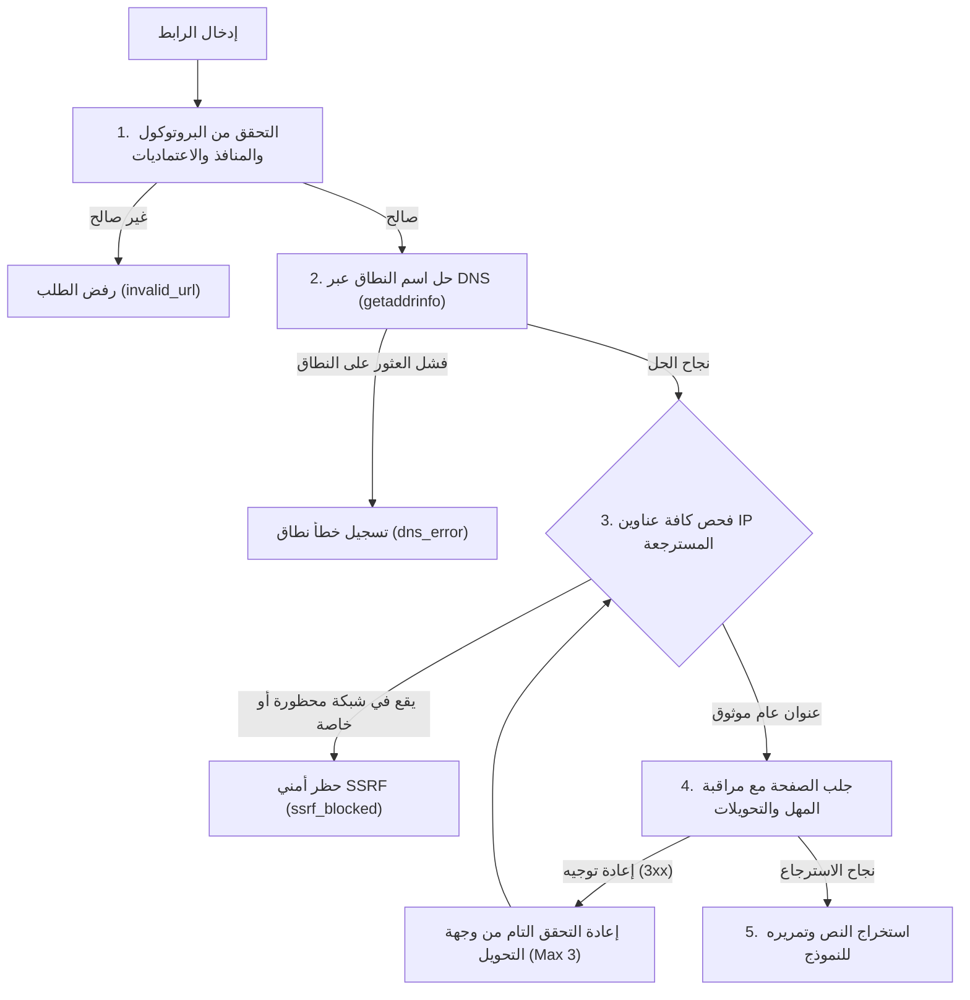

# SecureAct AI — Security Policy & Architectural Controls
## وثيقة السياسات الأمنية وضوابط الحماية الهندسية

تتبنى منصة **SecureAct AI** مبدأ الدفاع في العمق (*Defense-in-Depth*) عبر تطبيق ضوابط وقائية صارمة متعددة الطبقات لحماية موارد النظام، ومنع استغلال خادم التحليل، وتأمين وكلاء الذكاء الاصطناعي من محاولات التلاعب وحقن الأوامر (*Prompt Injection*).

---

## 1. ضوابط حدود الإدخال ومنع حجب الخدمة (Input Boundaries & DoS Prevention)

تطبق المنصة قيوداً إلزامية على مستوى الطبقة الوسيطة (*Middleware*) وعلى مستوى مسارات FastAPI للتحقق من المدخلات قبل وصولها إلى خوارزميات الاستدلال:

| الضابط الهندسي | الحد المعتمد | آلية الفحص | السلوك ورمز الاستجابة |
|---|---|---|---|
| **حجم طلب HTTP كاملاً** | **1 MiB** (1,048,576 بايت) | `RequestSizeLimitMiddleware` يفحص رأس `Content-Length` وتيار البيانات المباشر | **HTTP 413 Payload Too Large** |
| **حجم الملف المرفوع** | **100 KiB** (102,400 بايت) | قراءة وفحص بايتات الملف في نقطة `/api/predict/file` قبل فك الترميز | **HTTP 413 Payload Too Large** |
| **طول النص بعد فك الترميز** | **100,000 حرف Unicode** | فحص عدد محارف الـ Unicode الحقيقية (بما يراعي تعدد البايتات في العربية) | **HTTP 400 Bad Request** |
| **الحد الأدنى للمحتوى** | **1 حرف غير فارغ** | رفض النصوص الفارغة أو المحتوية على مسافات بيضاء فقط | **HTTP 400 Bad Request** |
| **أنواع الملفات المسموحة** | `.html`, `.txt` فقط | فحص لاحقة الملف ومطابقتها مع القائمة البيضاء المعتمدة | **HTTP 400 Bad Request** (`invalid_file_type`) |
| **تحديد معدل الطلبات (Rate Limiting)** | **30 طلباً في الدقيقة** لكل IP | نافذة زمنية منزلقة (*Sliding Window*) تعتمد على عنوان العميل وقراءة `X-Forwarded-For` | **HTTP 429 Too Many Requests** (مع ترويسة `Retry-After`) |

---

## 2. منظومة الحماية من تزوير الطلبات من جانب الخادم (SSRF Defense Engine)

تتضمن ميزة جلب وفحص صفحات الويب (*URL Scanner*) وميزة الفحص الجماعي (*Batch Scanner*) محرك حماية مخصصاً ومحكماً ضد هجمات SSRF، يطبق القواعد التالية قبل فتح أي اتصال بالشبكة:



### تفاصيل الحماية:
1. **القائمة البيضاء للبروتوكولات والمنافذ:**
   - البروتوكولات المسموحة: `http://` و `https://` فقط (حظر فوري لـ `file://`, `ftp://`, `gopher://`, `javascript:`, إلخ).
   - المنافذ المسموحة: `80`, `443`, `8080`, `8443` فقط (حظر منافذ الخدمات الداخلية مثل SSH:22 أو MySQL:3306).
   - حظر بيانات الاعتماد المضمنة في الرابط (`user:pass@host`).
2. **التحقق من DNS وعناوين IP المحجوبة:**
   - استعلام DNS استباقي عبر نظام التشغيل والتحقق من أن **جميع** عناوين IP المسترجعة لا تقع ضمن الشبكات المحجوبة:
     - عناوين الاسترجاع الذاتي (*Loopback*): `127.0.0.0/8`, `::1/128`.
     - الشبكات الخاصة (*RFC 1918*): `10.0.0.0/8`, `172.16.0.0/12`, `192.168.0.0/16`.
     - العناوين المحلية للارتباط (*Link-local*): `169.254.0.0/16`, `fe80::/10`.
     - نقاط بيانات السحابة الحساسة (*Cloud Metadata Endpoints*): `169.254.169.254/32` (AWS/GCP/Azure IMDS) و `fd00:ec2::254/128`.
     - شبكات Carrier-Grade NAT، والبث المتعدد (*Multicast*)، والشبكات المحجوزة للتوثيق.
3. **التحكم اليدوي في عمليات إعادة التوجيه (*Redirect Control*):**
   - تعطيل تتبع التحويلات التلقائي لمكتبة HTTP.
   - إعادة تطبيق فحص النطاق وSSRF بشكل كامل ومستقل على وجهة كل تحويل (حد أقصى 3 تحويلات).
4. **مهل الاتصال والحجم الأقصى للاستجابة:**
   - مهلة الاتصال (*Connect Timeout*): **8 ثوانٍ**.
   - مهلة القراءة (*Read Timeout*): **12 ثانية**.
   - الحد الأقصى لحجم استجابة الصفحة: **5 ميجابايت** (5,242,880 بايت) مع التحقق من نوع المحتوى (`text/html`, `text/plain`).
5. **التمييز الدقيق بين أخطاء الشبكة وحظر SSRF:**
   - يفصل النظام برمجياً بين تعذر إيجاد النطاق (`dns_error`)، وانتهاء المهلة (`connect_timeout`)، وحظر الأمان الحقيقي (`ssrf_blocked`)، لضمان عدم إيهام المستخدم بأن نطاقاً مفقوداً قد تم حظره أمنياً.

---

## 3. الخصوصية وعدم تخزين بيانات المستخدم (Privacy & Zero-Retention Policy)

1. **انعدام التخزين في الخادم:** لا تحتفظ خوادم المنصة بنصوص المستخدم الكاملة أو محتويات صفحات الويب المسترجعة في أي قاعدة بيانات دائمة.
2. **تنقية السجلات التشغيلية (*Log Sanitization*):** تقتصر سجلات الخادم على المقاييس الفنية (زمن المعالجة، رمز الاستجابة، ونوع العملية) مع الامتناع التام عن تسجيل نصوص الإدخال أو شفرات HTML.
3. **حماية التخزين المحلي في المتصفح (*Client-side Storage*):** تُحفظ ملخصات الفحوصات في `localStorage` للمستخدم محلياً لتشغيل ميزات السجل والمقارنة، ويتم حفظ أول 80 حرفاً فقط كمعرّف للهدف دون تخزين صفحات الويب الكاملة.
4. **منع هجمات Cross-Site Scripting (XSS):** يتم التعامل مع شفرات HTML المسترجعة أو المرفوعة كنصوص مجردة داخل وسوم العرض دون تنفيذ أي برمجيات JavaScript من جهة العميل.

---

## 4. التحقق التشفيري من نزاهة النموذج (Cryptographic Model Integrity)

- قبل معالجة أي طلب استدلال، يقوم الخادم بحساب بصمة SHA-256 لملف المصنف المحفوظ `secureact_ai_v2_model.joblib`.
- إذا اختلفت البصمة عن القيمة التشفيرية المعتمدة مسبقاً:
  ```text
  8569185d875a1bd76768e1a576c1cfcfd8ff6d74529cd5e646f67d610f2ece5c
  ```
  يرفض الخادم تحميل النموذج فوراً ويتوقف عن العمل، وتتحول استجابة نقطة `/health` إلى `503 Service Unavailable` لمنع هجمات استبدال النموذج (*Model Poisoning / Tampering*).

---

## 5. حدود الاستخدام والإفصاح العلمي (Scientific & Operational Limitations)

- **طبيعة المصنف:** يعتمد نموذج SecureAct AI v2 على تحليل مصفوفات TF-IDF للأحرف والكلمات مع مصنف `LinearSVC`.
- **معدل الإنذار الكاذب:** يسجل النموذج معدل إنذار كاذب قدره **6.03%** على عينة التقييم المعتمدة، مما قد يجعله يضع علامة اشتباه على مقالات أو نصوص تقنية تقتبس عبارات أمنية.
- **التوصية الأمنية:** يجب استخدام المنصة كطبقة تصفية استباقية سريعة ضمن استراتيجية الدفاع في العمق، وعدم الاعتماد عليها كبوابة أمنية وحيدة لمعالجة البيانات الحساسة.

---

## 6. الإبلاغ عن الثغرات الأمنية (Vulnerability Reporting)

إذا اكتشفت ثغرة أمنية أو سلوكاً غير متوقع في محرك فحص SSRF أو حدود الإدخال، يرجى فتح بلاغ أمني عبر مستودع المشروع أو التواصل الأكاديمي المسؤول مع فريق التطوير.
